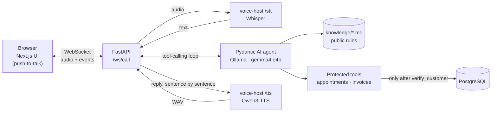
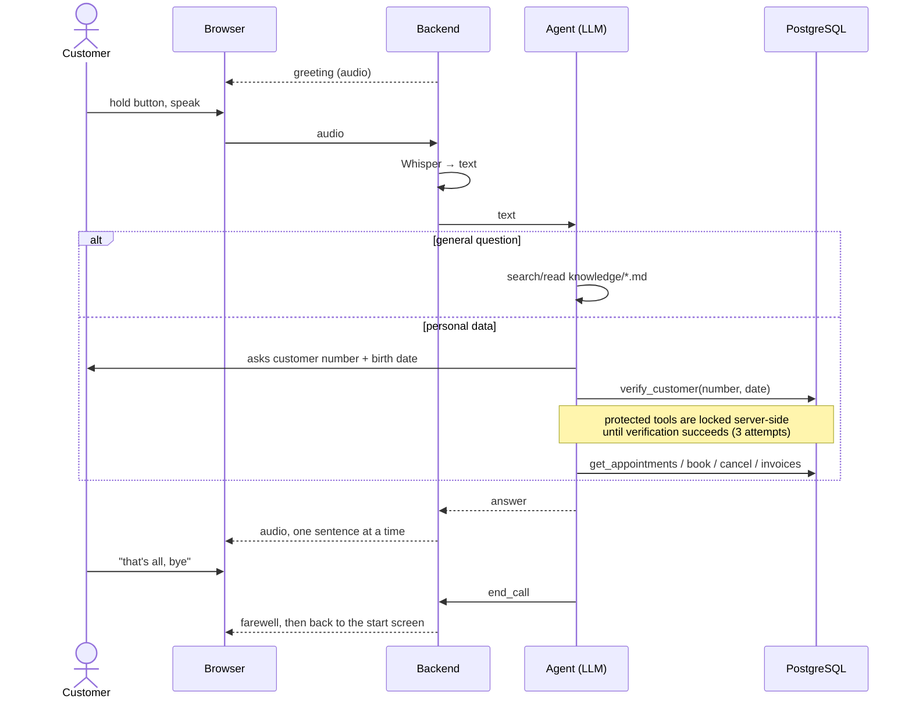

# dentist-agent

A voice-to-voice support agent for a dental practice. Customers talk (push-to-talk), the agent answers by voice, reads practice rules from Markdown files and unlocks personal data (appointments, invoices) only after customer number + date of birth. Everything runs locally.

**Stack:** Next.js + Tailwind · FastAPI + Pydantic AI · PostgreSQL · Docker Compose · Ollama (Gemma 4) · Whisper (MLX) · Qwen3-TTS (MLX)

## How it works





## Requirements

- macOS on Apple Silicon (MLX models), about 16 GB free RAM
- [Docker Desktop](https://www.docker.com/products/docker-desktop/), [Ollama](https://ollama.com), [uv](https://docs.astral.sh/uv/), `ffmpeg` (`brew install ffmpeg`)
- Disk space: about 20 GB for models (LLM 9.5 GB, Qwen3-TTS, Whisper 1.6 GB)

## Run

```bash
# 1. LLM
ollama pull gemma4:e4b

# 2. Voice host (speech-to-text / text-to-speech runs on the host for GPU access)
cd voice-host
uv venv --python 3.12
uv pip install -r requirements.txt
.venv/bin/python download_models.py
cd ..

# 3. Everything
cp .env.example .env
./dev.sh start        # voice host + Postgres + backend + frontend
```

Open <http://localhost:3000>, click **Gespräch starten** and hold the button (or the space bar) while speaking. The first start downloads the Qwen3-TTS model and takes a few minutes.

`./dev.sh stop | status | logs` · other voice: `TTS_ENGINE=piper ./dev.sh start` (`qwen-clone` default, `qwen-design`, `qwen-serena`, `piper`). `qwen-clone` speaks with the fixed voice in [`voice-host/voice/`](voice-host/voice) (`reference.wav` + its transcript `reference.txt`); `qwen-design` invents a new voice from `VOICE_DESCRIPTION` on every sentence, which is how a new reference clip is made.

Demo customers: `10001` (born 1988-04-12, appointments and an open invoice) and `10002` (born 2016-09-03, a child). Say the number digit by digit with short pauses, speech recognition drops zeros otherwise.

## Customize

- **Practice knowledge:** add or edit Markdown files under [`knowledge/`](knowledge) (e.g. `sonderregelungen/kinder.md`). The agent finds them without code changes.
- **Opening hours** also live in `OPENING_HOURS` in [`backend/app/booking.py`](backend/app/booking.py) (used for booking checks by the agent and the admin dashboard). Keep them in sync with the Markdown.
- **Config:** `.env` (`LLM_MODEL`, `LLM_REASONING`, `CORS_ORIGINS`, `ALLOWED_HOSTS`, `MAX_AUTH_ATTEMPTS`, `ADMIN_*`).
- **Admin dashboard:** http://localhost:3000/admin — appointments, customers and invoices (German UI). Set `ADMIN_USERNAME`, `ADMIN_PASSWORD` and `ADMIN_SESSION_SECRET` in `.env`; without them the dashboard is disabled.
- **Reset demo data:** `docker compose down -v && ./dev.sh start` (the database is reseeded when empty).
- **Backend dev setup:** `cd backend && uv venv --python 3.12 && uv pip install -r requirements.txt`
- **Text-only chat for testing:** `cd backend && .venv/bin/python -m app.cli "Hallo" "…"` (needs the stack from `./dev.sh start`).
- **Tests:** `cd backend && .venv/bin/python -m pytest` (auth lock-out, foreign-data access, booking rules, path traversal, admin login and actions).

## Notes

- Keep `LLM_REASONING=low`: with `none` the small model writes tool calls as plain text instead of calling them.
- Whisper hallucinates phrases like "Vielen Dank." on silence; the voice host gates quiet audio and filters those phrases.
- Local demo only: no user accounts, no TLS, demo data is seeded on first start.
